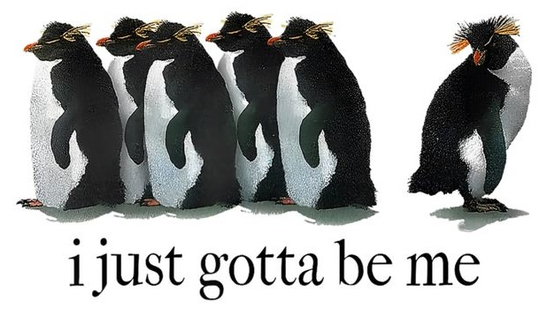

[github](https://github.com/samuelANROD) &nbsp;·&nbsp; [linkedin](https://www.linkedin.com/in/samuel-anacleto-rodrigues-a61abb407/) &nbsp;·&nbsp; [email](mailto:samuel.anacletorodrigues@gmail.com)

### profile

I'm a Software Engineering student interested in how computers, operating systems and software work at a deeper level.

My main focus is **cybersecurity**, especially offensive security and penetration testing: learning how systems operate, finding vulnerabilities and understanding how to secure them.

I love **Linux** and systems programming: distros, OS internals, computer architecture and memory management. Right now I'm sharpening **Python**, **C** and **C++**, plus algorithms and data structures.

Outside of code, I'm fascinated by astronomy, physics and scientific computing. Long term, I want to explore where programming meets astrophysics.

 

### stack

**Languages** &nbsp;&nbsp;&nbsp;&nbsp;&nbsp;&nbsp;&nbsp;&nbsp;&nbsp;&nbsp;&nbsp;&nbsp;&nbsp;&nbsp;&nbsp;&nbsp;&nbsp;&nbsp; **Tools**

&nbsp;&nbsp;&nbsp;&nbsp;&nbsp;&nbsp;&nbsp;&nbsp;&nbsp;&nbsp;

**Systems** &nbsp;&nbsp;&nbsp;&nbsp;&nbsp;&nbsp;&nbsp;&nbsp;&nbsp;&nbsp;&nbsp;&nbsp;&nbsp;&nbsp;&nbsp;&nbsp;&nbsp;&nbsp; **IDE & Editors**

&nbsp;&nbsp;&nbsp;&nbsp;&nbsp;&nbsp;&nbsp;&nbsp;&nbsp;&nbsp;

### activity

### interests

**Cybersecurity** · Offensive Security, Penetration Testing, Network Security 
**Systems & Computing** · Linux, Operating Systems, Computer Architecture, Low-level Programming 
**Software Engineering** · Development, Algorithms, Problem Solving 
**Science** · Astronomy, Physics, Scientific Computing

**SAMUEL ANACLETO RODRIGUES** 
ENGINEERING · COMPUTING · SECURITY 
<i>Always learning. Always building.</i>

